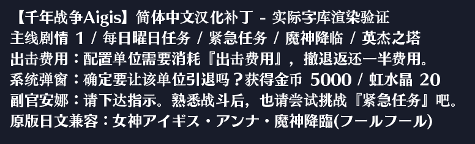

# 千年战争 Aigis (`aigis_exe`) 逆向研究与非侵入式全量简体中文汉化工具链

> ### ⚠️ 免责声明 / Disclaimer（请务必阅读）
> 1. **仅供个人学习与逆向工程研究使用**：本仓库所有代码、格式解析文档与汉化词典仅用于计算机软件逆向工程、二进制数据结构分析、位图字库渲染及机器翻译本地化技术的**个人学习与研究**。
> 2. **不包含任何游戏原始二进制资产**：本仓库通过 `.gitignore` 严格排除了原版游戏的任何受版权保护二进制文件（`.exe`、`.cache/` 原始资源与备份文件），仅提供解析/打包脚本与纯文本翻译映射表，使用者必须在本地拥有合法获取的原版游戏客户端方可自行构建。
> 3. **非侵入式安全原则**：本工具**不修改** `Aigis.exe` 可执行文件、**不注入**任何 DLL 或内存 Hook、**不触碰**本地 DPAPI 账号凭据文件、**不改动**任何游戏玩法/数值/网络协议逻辑。
> 4. **风险自负**：严禁将本项目用于任何商业用途、二次收费分发或违反游戏服务条款（ToS）的行为。因使用本项目产生的任何后果由使用者本人承担。

---

## 一、项目概览与全量汉化覆盖率

本项目针对《千年战争 Aigis》（千年戦争アイギス）DMM Windows 客户端（`aigis_exe`，Aqualead 引擎），实现了从 **`ALL4` / `ALTB` / `ALRD` / `ALFT` / `ALIG` / `ALAR v3` 二进制格式无损编解码**、**粗宋体（华文中宋）位图字库动态重构** 到 **本地部署腾讯混元 `Hy-MT2-1.8B` GPU 批量翻译** 的完整工具链。

### 字库实际渲染预览（`MainFont.aft` 28×28 4bpp PAL4 位图字库）



### 全量汉化覆盖统计（45/45 张表与归档 100.0% 覆盖）

总词典规模：**85,945 条唯一日文译文**，覆盖全游戏 **134,045 / 134,045（100.0%）** 条展示文本与剧情台词：

| 类别 | 资源表 / 归档名称 | 汉化条目 / 总条目 | 覆盖率 | 说明 |
| --- | --- | --- | --- | --- |
| **技能与被动** | `SkillList.atb` | `4,020 / 4,020` | **100.0%** | 全部单位技能名称 |
| **技能与被动** | `SkillText.atb` | `3,936 / 3,936` | **100.0%** | 全部单位技能效果说明 |
| **技能与被动** | `AbilityList.atb` | `2,435 / 2,435` | **100.0%** | 全部被动 / 觉醒特性名称 |
| **技能与被动** | `AbilityText.atb` | `2,319 / 2,319` | **100.0%** | 全部被动 / 觉醒特性效果说明 |
| **角色与职业** | `NameText.atb` | `5,898 / 5,898` | **100.0%** | 全部角色 / 单位 / 召唤物名称 |
| **角色与职业** | `PlayerUnitTable.aar` (`ClassData.atb`) | `3,488 / 3,488` | **100.0%** | 全部 2,009 项职业名与职业特性说明 |
| **角色与职业** | `PlayerTitle.atb` | `257 / 257` | **100.0%** | 全部王子称号与属性加成说明 |
| **角色与职业** | `StatusText.atb` | `18,032 / 18,032` | **100.0%** | 全部角色立绘台词、图鉴简介与副官语录 |
| **关卡与加护** | `MessageText.atb` | `537 / 537` | **100.0%** | 全部关卡介绍、★4 挑战条件说明与功能引导 |
| **关卡与加护** | `BattleGodBlessConfigTable.atb` | `484 / 484` | **100.0%** | 全部战神加护名称与效果 |
| **关卡与加护** | `BlessingText.atb` | `53 / 53` | **100.0%** | 全部女神加护名称与效果 |
| **关卡与加护** | `QuestNameText.atb` / `EventNameText.atb` 等 22 张任务表 | `4,002 / 4,002` | **100.0%** | 主线、每日、英杰/统帅/恶灵之塔、大讨伐、魔神、神兽、斗技场、帝国、紧急、复刻、历史等全部关卡与活动名 |
| **系统与界面** | `SystemText.atb` | `6,321 / 6,321` | **100.0%** | 全局系统文案、战斗提示、兵舍/仓库、召唤概率、种族/属性、背景名、商店礼包与活动公告 |
| **系统与界面** | `UiText.atb` / `MessageBoxText.atb` / `GuideText.atb` / `GoQuestWarningText.atb` 等 6 张表 | `467 / 467` | **100.0%** | 全部菜单标题、120 篇游戏帮助手册、系统弹窗、安娜引导与出击编队警告 |
| **剧情对话** | `QuestEventText.atb` | `3,862 / 3,862` | **100.0%** | 主线与关卡战斗前后剧情对话 |
| **剧情对话** | `EventHomeArc.aar`（320 段嵌套 `.aar`） | `11,157 / 11,157` | **100.0%** | 主页与周年庆特别剧情对话 |
| **剧情对话** | `EventArc.aar`（829 段嵌套 `.aar`） | `30,906 / 30,906` | **100.0%** | 历代活动与主线演出剧情对话 |
| **剧情对话** | `paev03.aar`（454 段嵌套 `.aar`） | `35,887 / 35,887` | **100.0%** | 角色个人 / 好感交流剧情对话 |
| **位图字库** | `MainFont.aft` / `MainFontFix.aft` | `4,257` / `3,978` 字形 | **100.0%（0 缺字）** | 华文中宋（`STZHONGS.TTF`）重制双字库，100% 覆盖全部 **3,802 个简体中文字符** |

---

## 二、逆向工程核心技术原理

1. **SHA-256 资源命名映射**
   - `Aigis.exe`（无壳 32 位 x86 MSVC PE）将逻辑资源文件名直接通过 `SHA256(filename)` 映射为磁盘文件名：
     - `SHA256("MainFontFix.aft")` = `f00e83cfe03f3252...`（根目录引导字库，`1,618,424 B`）
     - `SHA256("MainFont.aft")` = `cd4215ec2d8f4371...`（`.cache/` 主字库，`1,727,372 B`）
     - `SHA256("SystemText.atb")` = `d41419e0955a...`

2. **免改 `Aigis.exe` 的缓存校验机制（`0xa45f40` / `0xa463e0`）**
   - 反汇编 `Aigis.exe` 证实：客户端校验 `.cache/<sha256>` 是否需要重下载时**仅检查两项**：
     1. 本地文件大小 `file->GetSize() == expected_size`（`0xa46055` / `0xa4646c`）
     2. 伴随文件 `.cache/<sha256>.md5` 内的 32 字节文本与服务端清单一致（`strncmp`，`0xa4613f` / `0xa4655a`）
   - 客户端**不会在读取缓存时重新计算数据文件本身的 MD5**，且 `ALL4`（`0xbabf66`）、`ALTB`（`0xb0b965`）、`ALFT`（`0xb29697`）三大解析器均忽略文件末尾的 `\x00` 填充。
   - 由于中文字符串池及 LZ4 压缩后体积普遍小于日文原版，只需将回封后的文件**末尾零填充至与原文件完全一致的字节数**，并保持 `.md5` 文件原样不动，即可实现**零 `.exe` 修改、零注入、100% 字节级无损还原**。

3. **`ALFT` + `ALIG` 位图字库结构与缺字攻克**
   - 原版字库采用 `ALFT`（14 字节头 + `rcnt` 个 `(start_u16, end_u16, base_idx)` 连续码位区间 + `wcnt` 个字宽表 + 4 字节对齐 `ALIG` `PAL4/RGBA` 256px 宽 4bpp 灰度图集，**高半字节为左像素、低半字节为右像素**，单元 `28×28`、汉字字宽 `24px`、墨迹框 `x[0..23], y[0..23]`）。
   - 原版 `MainFont.aft` 仅含日文 JIS 字集，缺失近半数常用简体字，但含有 **1,488+ 个未被实际文本引用的空闲字槽**（西里尔字母、希腊字母、生僻 JIS 二级汉字及汉化后不再被引用的纯日文汉字）。
   - `font_builder.py` 自动扫描汉化后实际使用的全部字符集，保留 ASCII、假名与仍被引用的日文汉字，将空闲槽位替换为使用 Windows **华文中宋（`STZHONGS.TTF`）** 4 倍超采样渲染的 `28×28` 4bpp 简体汉字，并精确补齐至原文件字节长度。

4. **列级安全白名单（杜绝破坏脚本逻辑）**
   - 部分 `.atb` 表（如 `SkillInfluenceConfig.atb`、`AbilityConfig.atb`、`Enemy.atb`、`ClassData.atb` 的 `DisplayPermission` 列、`PlayerTitle.atb` 的 `_ExpressionValue` 列）包含 `IsEnemyRace("ゴーレム")` 等内部脚本条件式。
   - `catalog.py` 采用严格的**表级 + 列级双重白名单**，仅替换面向玩家展示的纯文本列，其余列与记录二进制原样保留。

---

## 三、使用方法

### 1. 环境准备

- Windows 10/11（需已安装 `C:\Windows\Fonts\STZHONGS.TTF` 华文中宋或宋体/微软雅黑）
- Python 3.10+，安装基础打包依赖：
  ```powershell
  pip install -r requirements.txt
  ```
  > 注：如果默认游戏路径不是 `d:\game\DMM\aigis_exe`，可在命令行添加 `--game-dir "你的aigis_exe路径"`。

### 2. 双击 `.bat` 一键使用（推荐）

在仓库根目录下直接双击对应批处理脚本（**操作前请先关闭游戏**）：

| 脚本文件 | 功能说明 |
| --- | --- |
| `1_安装汉化补丁.bat` | 若本地尚未构建 `patch_out/`，会自动先从本地游戏目录构建补丁，随后将 47 个原始文件备份到 `backup/` 并写入汉化补丁 |
| `2_还原日文原版.bat` | 从 `backup/` 将 47 个原始文件 100% 字节级覆盖还原回游戏目录 |
| `3_查看补丁状态.bat` | 检查当前游戏目录中各文件处于 `patched`（已汉化）、`original`（原版）还是 `modified/updated by game`（已被官方热更新）状态 |
| `4_游戏更新后重新汉化.bat` | **官方每周维护/热更新后专用**：自动识别被官方更新的文件、同步新备份、重新提取最新表、调用本地 `Hy-MT2-1.8B` 增量翻译新增词条并重新打包安装 |

### 3. 命令行方式使用

```powershell
# 1. 构建并校验全部 47 个汉化文件（含双字库重排与 100% 字形覆盖校验）
python patcher.py build --game-dir "d:\game\DMM\aigis_exe"

# 2. 单独运行完整性校验（字节长度 + 往返解码 + 0 缺字校验）
python patcher.py verify --game-dir "d:\game\DMM\aigis_exe"

# 3. 安装汉化补丁（首次运行自动备份原文件到 backup/）
python patcher.py apply --game-dir "d:\game\DMM\aigis_exe"

# 4. 查看当前补丁状态
python patcher.py status --game-dir "d:\game\DMM\aigis_exe"

# 5. 一键无损还原回日文原版
python patcher.py restore --game-dir "d:\game\DMM\aigis_exe"
```

---

## 四、游戏每周四维护 / 版本更新后怎么办？

由于《千年战争 Aigis》通常在每周四进行停机维护或热更新，服务端会更新部分数据表（如 `SystemText.atb`、`SkillText.atb`、`NameText.atb`、`EventArc.aar` 等）的文件大小和预期 MD5：

### 现象
- 游戏更新后启动时，客户端会检测到被更新的那几张表的服务端 MD5 发生了变化，从而**自动从官方 CDN 重新下载新版原文件**覆盖本地对应文件（**完全不会报错或损坏客户端**，未更新的表仍保持中文，只有本周更新的表会变回日文）。

### 解决步骤（一键同步更新）
1. 先正常启动一次游戏，让客户端把官方最新资源下载完，然后**关闭游戏**。
2. 直接双击运行 **`4_游戏更新后重新汉化.bat`**（或命令行执行）：
   ```powershell
   # 仅用现有 8.5 万条词典重新适配新表体积并打包（耗时约 15 秒）：
   python update_after_maintenance.py

   # 或者：同时调用本地部署的 Hy-MT2-1.8B 自动增量翻译本周新增的日文词条（推荐）：
   python update_after_maintenance.py --translate-new
   ```
3. **它的内部安全机制**：
   - 自动对比游戏目录中每个文件的 SHA-256：
     - 对**未被官方更新**的文件：先从 `backup/` 还原出干净原版用于重新提取；
     - 对**已被官方更新**的文件：**绝不用旧 `backup/` 覆盖新文件**，而是自动用官方新下载的文件更新 `backup/` 基准！
   - 重新运行 `extract.py` 提取最新表结构；
   - 将已有 85,945 条译文（加上增量翻译的新词条）按新版文件的精确字节大小重新回封、重排字库并自动安装。

---

## 五、本地部署 `Hy-MT2-1.8B` 与自定义译名

### 1. 本地部署腾讯混元 `Hy-MT2-1.8B`（可选，用于增量翻译新版本剧情/活动）
`local_hymt2_translate.py` 内置了 **ModelScope 国内源（`Tencent-Hunyuan/Hy-MT2-1.8B`）16 线程断点续传下载器**，默认将模型下载至 `D:\models\Hy-MT2-1.8B`（约 `3.80 GB`），并在支持 CUDA 的显卡（如 RTX 4060 8GB，仅占 `3.34 GB` 显存）上以 `bfloat16` + `SDPA` 批量推理：

```powershell
# 翻译指定表并保存到 translations/ 下
python local_hymt2_translate.py --tables QuestEventText.atb --batch-file batch_99_incremental.json --batch-size 48

# 启动本地 HTTP 翻译 API 服务（POST http://127.0.0.1:8000/translate {"texts": ["..."]}）
python local_hymt2_translate.py --serve --port 8000
```

### 2. 如何自定义或修改某条译名
所有译文均以明文 UTF-8 JSON 格式存储在 `translations/` 目录下（其中 `glossary_zh.json` 优先级最高，会覆盖 `batch_*.json` 中的同名键）：

| 词典文件 | 对应内容 |
| --- | --- |
| `translations/glossary_zh.json` | 核心界面、帮助手册、弹窗、安娜引导、出击警告、女神加护、王子称号（最高优先级，自定义译名可直接加在此文件） |
| `translations/batch_01_missions_blessings_classes.json` | 关卡介绍、战神加护、全部职业名与职业特性说明 |
| `translations/batch_02_skills_abilities_names.json` | 全部单位技能名、被动名与角色名 |
| `translations/batch_03_skill_ability_texts.json` | 全部技能效果说明与被动效果说明 |
| `translations/batch_04_system_text.json` | 全局系统、商店礼包、召唤说明与活动文本 |
| `translations/batch_05_story_quest.json` | 主线与关卡战斗前后剧情对话（`QuestEventText.atb`） |
| `translations/batch_06_story_events.json` | 主页/周年庆与历代活动剧情对话（`EventHomeArc.aar` + `EventArc.aar`） |
| `translations/batch_07_status_text.json` | 角色立绘台词与图鉴简介（`StatusText.atb`） |
| `translations/batch_08_story_paev03.json` | 角色个人交流剧情对话（`paev03.aar`） |

修改任意 JSON 文件后，运行 `python patcher.py build` 与 `python patcher.py apply`（或双击 `1_安装汉化补丁.bat`），工具会自动将新字符渲染进字库并更新补丁。
